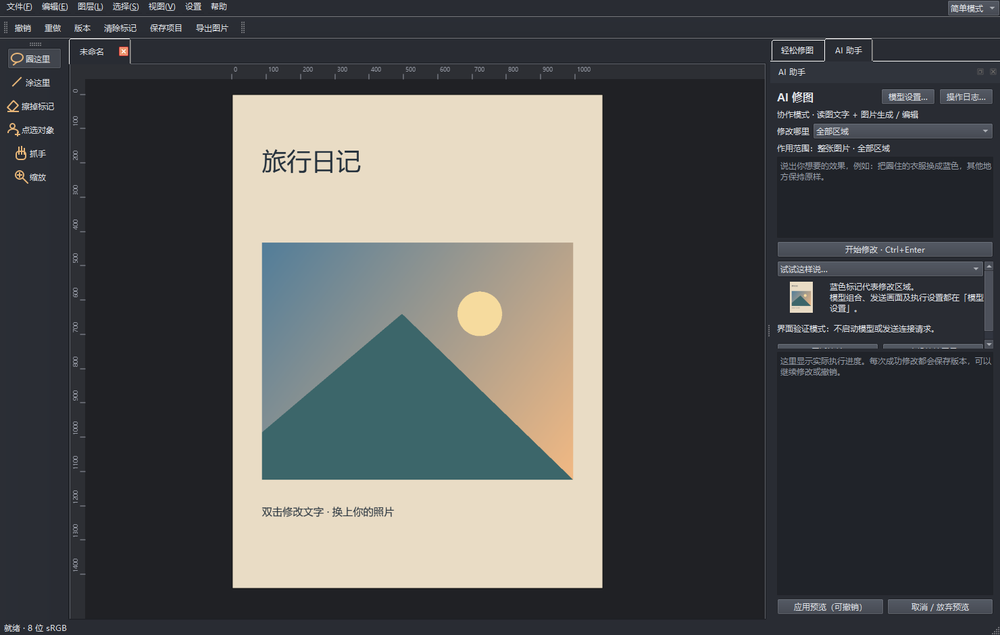

# 我把“会听人话”的修图工具做成了 Windows 应用：圈个大概，也能改对地方

**映绘 Yinghui 0.4.5｜中文修图、专业图层与本地 AI 协作**

你可能有过这样的时刻：照片拍得很好，却觉得主体暗了一点；想把车换个颜色，只会说“改这辆车”，不会画严丝合缝的选区；想给旅行照加个中文标题，结果在一堆图层和参数里找了半天。

我做映绘，想让修图从一句人话开始。打开照片，输入“把主体稍微提亮，颜色自然一点”，软件会把想法拆成具体操作，再调用自己的调色、选区或图片编辑工具。你仍然能看到实际步骤，也能撤销、比较版本、继续说“再亮一点”。

## 圈得不准，先告诉它你想改什么

简单模式左边保留几个直观入口：“圈这里”“涂这里”“点选对象”。蓝色只是区域标记，不会留在照片上。

如果边界已经画准，就选“仅圈选区域”：软件严格在这块区域内修改。假如你只大概圈到车门，却想给**整辆车**换色，可以选“大致位置”。映绘会把干净的整图、区域标注和局部细节交给看图模型，让它先判断目标，再用本机对象识别模型找实际边缘，最后交给图片模型改图。模型认不清或区域不合理时，会停止任务，让你重新标记。

我们用一张真实照片做过完整测试：在白色汽车附近粗略圈画，输入“把这辆车改成红色，背景保持原样”。看图模型定位整辆车，图片模型完成改色，本机合成后检查识别区域以外的像素，结果为 **0 处变化**。这是一项具体样例和范围保护的测试，不意味着任何复杂物体都能百分之百认准；透明边缘、遮挡和多人照片仍建议先预览。

精确要求则走另一条路。你说“选中区域亮度增加5度，其他参数不要动”，映绘直接修改亮度参数的 5 个点，并保留其他参数，不会把这句话交给生图模型随意“猜一个差不多的效果”。

## 不想学图层？先从简单模式开始

首页可以打开照片、试用离线示例，也能进入美化照片、加文字、拼图和海报。自动优化、12 款可调强度滤镜、常用裁剪比例、六种拼图布局、六种基础海报模板都可以直接试。想加字，就输入“右下角加上‘周末旅行’”；中文文字仍可再次编辑。

我很在意“改过之后还能继续改”。映绘保存原像素与调色参数；AI 成功修改一次，就是可撤销的一步和一个可恢复版本。你可以继续输入下一句，也可以回到之前的状态试另一种方案。正式项目保存为 `.comp`，导出图片用于分享，两个动作各司其职。

如果你熟悉传统修图工具，切到专业模式，刚才的文档原封不动地继续用：图层、分组、蒙版、画笔、选区、曲线、色阶、调整层、混合模式、文字和变换都在。简单与专业不是两份互不相干的作品，而是同一张图的两种操作方式。

## 两类模型，各干各的活

映绘把“读图文字模型”和“图片生成 / 编辑模型”分开设置。前者看图、理解中文、调用调色或文字工具；后者负责真正生成或修改像素。你可以只开一种，也可以两种都勾选。模型设置是独立的大窗口，操作日志另开，不让一堆参数挤进修图聊天框。

完整安装包里提供 Qwen3.8 27B 和轻量 Qwen3.5 2B 看图助手，以及图片引擎和本地运行库。运行时尝试可用的 GPU，必要时回退 CPU；大图模型和看图模型协作时，软件会交接自身占用的显存。每个看图型号能单独记设备、线程与上下文；图片型号的尺寸、步数和备用引擎也分别保存。开发者还能检查或修改运行脚本、指定自编译运行库，然后恢复默认环境。

机器配置不够时，可以从 2B 开始。即使 AI 服务临时不可用，打开照片、画画、调色、加字、保存和导出仍可照常使用。

## 文件不止照片，也能认真做项目

PNG、JPEG、WebP、TIFF 等常见图片都能导入同一套编辑流程；GIF 导入首帧，SVG 栅格化，8 位 RGB PSD/PSB 可导入图层内容。分享时能导出常见图片、带透明度与 DPI 的合成 TIFF，以及基础分层 PSD。自己的完整编辑状态放在 `.comp` 项目里保存。

这里我想把边界说清楚：映绘目前主要工作在 **8 位 sRGB**。RAW、CMYK、16/32 位编辑、完整 Photoshop 往返和完整液化仍在后续规划。PSD 的某些效果、文字或调整导出时会烘焙，并提供转换提示。它正在成长，不会假装已覆盖所有 Photoshop 工作流。

## 把代码打开，也把许可说清楚

Windows 版代码和原有 macOS 工程会一起提供源码包，保留仓库的 MIT 许可证与原作者声明。本版在 Windows 11 上通过 137 个原生测试用例、11 个界面场景，以及真实本地模型的看图、改图、局部保护和连续修改测试。Windows 10 干净环境、更多显卡和复杂 Photoshop 文件还需要社区一起验证。

完整安装包包含第三方组件，它们各有许可证。特别是随包的 **Qwen-Image-2.1 权重只授权研究和评估**，商用需另行取得授权；应用源码采用 MIT，并不等于所有随包模型也属于 MIT。交付目录里附了专门的许可说明和上游署名。

如果你是不想先背工具名、只想把照片修好的普通人，欢迎从简单模式试一句话；如果你喜欢拆解算法、改模型环境或做专业工作流，欢迎看源码和提问题。这个项目还有很多可以变好的地方，我希望每一次改进都能被看见、验证，也能被继续编辑。

**下载与开源地址：**发布时请在这里填入安装包下载链接和源码仓库链接。

**安装提醒：**完整安装由一个 Setup.exe 和多个同名前缀的 `.bin` 文件组成，下载后放在同一文件夹。安装目录约需 45 GB；安装包若也保留在同一盘，请另外预留空间。使用方法和已验证范围见同目录的《使用手册》《功能说明》。
